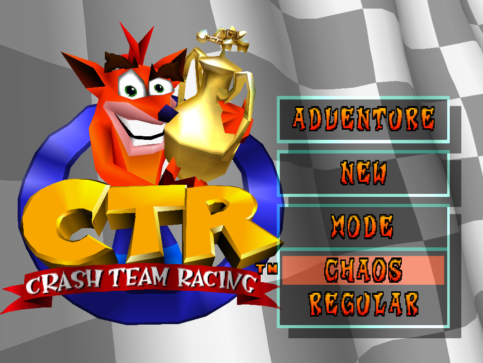
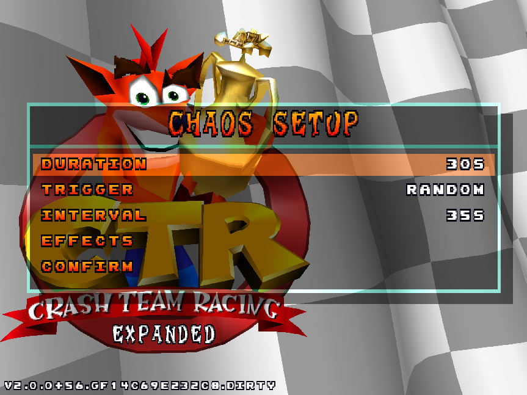
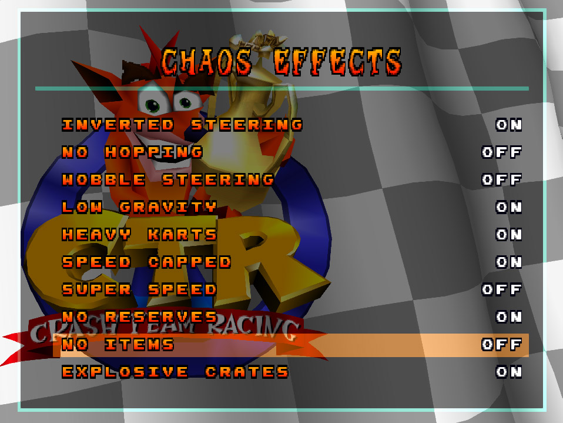
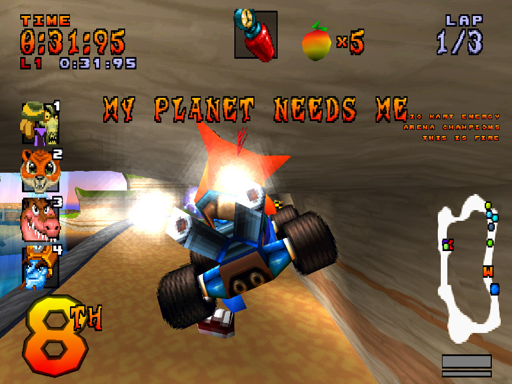
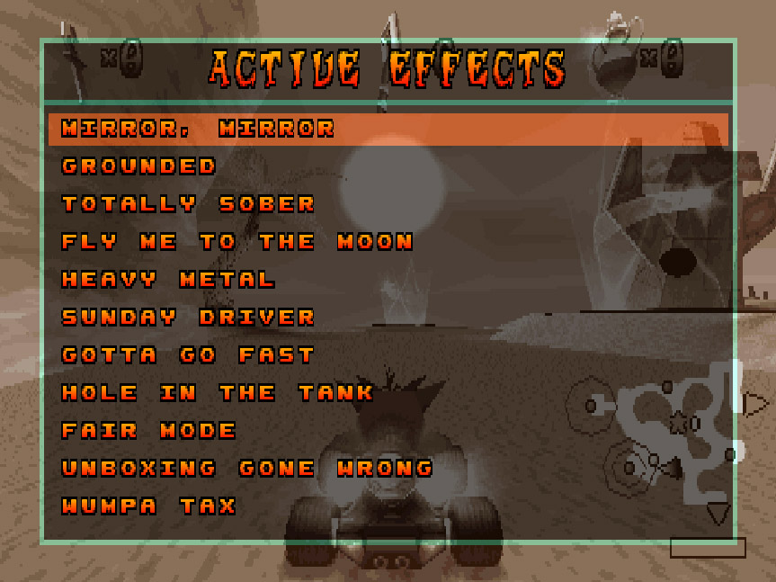

# Chaos mode

Chaos adds temporary gameplay effects to Adventure: reversed steering, giant
karts, explosive crates and more. You choose which effects can appear and what
triggers them when creating the Adventure file.

It works in solo Adventure and [2P co-op Adventure](2P_ADVENTURE.md).
The hub is unaffected; Chaos runs in Adventure events,
including trophy, boss, CTR, relic, crystal and gem-cup challenges.

## Starting a Chaos file

1. Enable **Chaos Mode** under **Adventure** in the in-game **Options Config**
   menu, or set `chaos_mode = true` in the `[Adventure]` section of `config.ini`.
2. Start a **New Adventure** and choose **Chaos** at the mode prompt. Choose
   **Regular** to create an ordinary Adventure instead.
3. Configure Chaos, select **Confirm**, then continue to character selection.

The global option only enables this creation prompt. Your choice and Chaos rules
are stored in the Adventure save slot. Loading a Chaos file does not show setup
again, and turning the global option off does not disable Chaos in that file.
Existing Regular files stay Regular.

## Choosing the rules

| Setting | Meaning |
| --- | --- |
| **Duration** | How long timed effects last: 5–60 seconds, in 5-second steps. Default: 30 seconds. Instant rewards apply once. |
| **Trigger** | What causes the next activation; see below. Default: Random. |
| **Interval** | Gap used by Random, Interval and External: 5–120 seconds, in 5-second steps. Default: 35 seconds. Hidden for Pickup. |
| **Effects** | Open the list and turn individual effects ON or OFF. All are selected initially. |
| **Confirm** | Accept these rules. At least one effect must be selected. |

Use Up/Down to navigate, Left/Right to adjust numeric values, and Cross/Circle to
cycle the trigger, open Effects or toggle an effect. Triangle returns from the
effect list to setup. These refer to the game's mapped controller buttons.

**Rules are fixed once the file is created.** To play with another trigger,
duration, interval or selection, create another Adventure file.

## Triggers

### Interval

After the configured interval, activate one randomly selected enabled effect.
Repeat at that interval while the race is running. The first interval starts
from GO.

### Random

Like Interval, but each gap is randomly chosen between **30% and 100%** of your
Interval setting, including the first gap. With Interval set to 35 seconds, the
next effect arrives after approximately 10.5–35 seconds of active race time.

### Pickup

Activate one randomly selected enabled effect when a human:

- consumes an item, Wumpa or time crate;
- collects loose Wumpa, a crystal or a CTR letter;
- enters a normal or super turbo pad.

### External

An external application chooses the effect by placing its name in a local file.
The game waits one full Interval from GO, then reads the next request. Each
successful activation starts a fresh interval. With no request, no effect starts.

Requests wait through pauses and can carry over to the next race, which starts a
new interval from GO. The selected effect uses your saved Duration and must be
enabled in the file. Setup and a manual submission example are in the
[external provider guide](CHAOS_EXTERNAL_PROVIDER.md).

## Effects

| Effect                  | What happens                                                                                                                                                                    |
|-------------------------|---------------------------------------------------------------------------------------------------------------------------------------------------------------------------------|
| **Inverted Steering**   | Left and right steering are reversed.                                                                                                                                           |
| **No Hopping**          | Manual hopping is disabled. Existing drifts and forced jumps can still happen.                                                                                                  |
| **Wobble Steering**     | Steering sways from side to side, making a straight line harder to hold.                                                                                                        |
| **Low Gravity**         | Gravity falls to one quarter of normal, keeping you airborne longer.                                                                                                            |
| **Heavy Karts**         | Gravity triples, bringing you down sooner after jumps.                                                                                                                          |
| **Speed Capped**        | Forward target speed is capped at half your kart's normal class speed, including while boosting.                                                                                |
| **Super Speed**         | Doubles forward target speed and acceleration. The game's usual speed ceiling still applies.                                                                                    |
| **No Reserves**         | Continually clears stored boost fuel, preventing you from building up reserves.                                                                                                 |
| **No Items**            | Empties held items and cancels item rolls. Already deployed items, shields and masks remain active.                                                                             |
| **Explosive Crates**    | Item, Wumpa and time crates explode when you drive into and break them. The blast can hurt you through mask or shield protection.                                               |
| **Wumpa Drain**         | Removes one collected Wumpa per second until you reach zero.                                                                                                                    |
| **Clock Curse**         | Applies an initial spin hit and clock slowdown. The initial hit bypasses mask and shield protection.                                                                            |
| **Defective Boosts**    | While you have reserves, the fire-speed bonus becomes a penalty instead.                                                                                                        |
| **Anxious Mask**        | Contact with slowing terrain, such as off-road surfaces, requests a normal mask rescue back to a checkpoint. Normal rescue penalties apply.                                     |
| **Hard Crates**         | Item, Wumpa and time crates become solid obstacles when you drive into them, instead of breaking and giving rewards.                                                            |
| **Giant Karts**         | Doubles kart size and lateral collision size, adds 30% to forward target speed and jump force, and lets larger karts squash smaller ones. Protected karts can resist squashing. |
| **Use This!**           | Replace each human's item with a random one.                                                                                                                                    |
| **Juiced Up**           | Fill Wumpas to ten.                                                                                                                                                             |
| **It is I**             | Activate or renew a normal mask without consuming inventory, using normal Wumpa and duration rules.                                                                             |
| **Providence**          | Activate or renew a normal shield without consuming inventory, using normal Wumpa, color and duration rules.                                                                    |
| **Reserve Injection**   | Bring reserves to at least ten seconds; give third-drift-boost fire if not already boosting. Preserve an existing boost and any larger reserve balance.                         |
| **Too Boosted TO Fail** | Boosts can add reserves, but consumption, damage, U-turns and rescues cannot reduce them while the effect lasts.                                                                |
| **Sabotage**            | Disable braking and reverse, including airborne braking and analog brake/reverse input. Forward throttle remains available.                                                     |
| **This Is Fire** | Upgrade existing turbo and new boosts to USF without free reserves. Earned USF remains after expiry until normal gameplay removes it. |

Effects can overlap: Duration does not delay the next trigger. For example,
Duration 30 seconds with Interval 10 seconds allows several effects at once.

- Up to **four distinct timed effects** can be active. A fifth unrelated timed effect is
  ignored; refreshing or replacing an existing effect is still possible.
- Triggering an active effect starts its duration over and announces it again;
  it does not multiply that effect's strength.
- These pairs replace one another: **Inverted Steering / Wobble Steering**,
  **Low Gravity / Heavy Karts**, **Speed Capped / Super Speed**,
  **No Reserves / Too Boosted TO Fail**, and **This Is Fire / Defective Boosts**.
- **Use This!** ends **No Items**; **Reserve Injection** ends **No Reserves**.
- The five instant rewards (**Use This!**, **Juiced Up**, **It is I**,
  **Providence**, **Reserve Injection**) take no timed slot. Repeating one applies
  its reward again.

## During a race

A sound and on-screen banner announce each activation. After a few seconds, its
name moves into the smaller list on the right. Instant rewards show only the
initial banner and never dock, even when their gameplay result persists.

Chaos timers stop in pause menus and outside active races. 

To inspect those rules, pause and choose **Chaos Rules**.

## Saved games

Normal Adventure saves retain your Chaos rules, not an in-progress set of effect
timers. Quick states also capture the current race and active effects.
